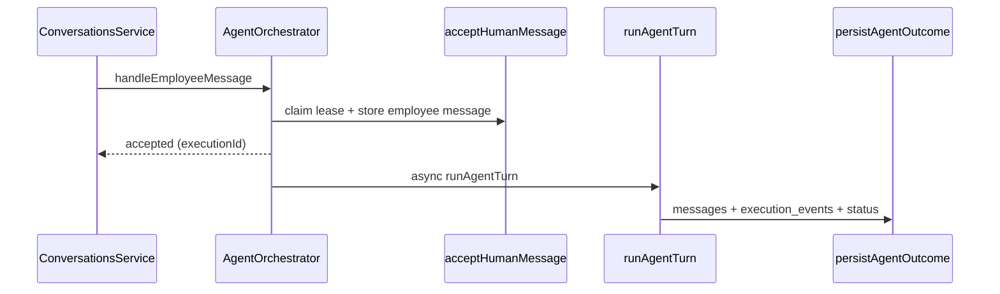

# Agent module

Location: `apps/api/src/agent/`.

The Nest public surface is `AgentOrchestrator` + `PolicyEngine` (registered in `app.module.ts`). Other files are internal to the agent pipeline.

## Folder layout

```
agent/
  agent.types.ts          Shared turn/persist types
  orchestrator/           Accept message, lease, persist outcome, Nest facade
  turn/                   One-turn runner + HITL shortcuts before/alongside LLM
  drafts/                 Pending draft CRUD, confirm/reject, feedback text
  providers/              LlmProvider contract, OpenAI-compatible, scripted, Mastra
  tools/                  Tool definitions + execution (help / tickets / prepare_draft)
  policy/                 Nest PolicyEngine wrapping domain priority/duplicity helpers
  intents/                Transfer phrases, impact-scope parsing, handoff summary
```

Tests are co-located next to the units they cover.

## Lifecycle



1. **Accept** (`orchestrator/agent.accept.ts`) — atomic lease via `busyUntil`; rejects concurrent executions.
2. **Turn** (`turn/agent.turn-runner.ts`) — out-of-IT redirect; draft confirmation / impact / complement shortcuts; Mastra or scripted tool loop (max 4 steps); handoff offers.
3. **Persist** (`orchestrator/agent.persist.ts`) — fences on `activeExecutionId`; writes agent message, events (with confidence), optional draft, conversation status.

Lease constants: `orchestrator/agent.lease.ts` (derived from UsageGuard timeouts).

## Tools vs mutations

Allowed model tools (`tools/agent.tools.ts`):

- `search_help`
- `list_my_tickets`
- `get_ticket`
- `prepare_draft` (writes a **draft**, not a ticket)

Ticket create / update / reopen / transfer run only through `TicketGateway` after HITL confirm of an exact `draftId` + `version` (see ADR 0003).

## Providers

| `LLM_PROVIDER` | Path | Role |
|---|---|---|
| `openrouter` / `openai` | `providers/mastra.ts` | `@mastra/core` Agent + Zod tools |
| `scripted` | `providers/scripted.llm.provider.ts` | Deterministic flows for CI/demo |

Factory: `providers/llm.provider.ts` (`createLlmProvider`).

## Intents and HITL helpers

- `intents/impact-answer.ts` — “who is affected?” parsing and title/category hints.
- `intents/transfer-intent.ts` — explicit analyst transfer phrases.
- `intents/handoff-summary.ts` — unsure/overdue offer text + structured console summary.
- `turn/agent.turn-confirm.ts` — button/phrase draft confirm, impact answer → `prepare_draft`, complement start.

## Observability

Turn events use Nest `Logger` context `AgentTrace` (`observability/agent-trace.log.ts`). Filter API logs with `grep AgentTrace`.
