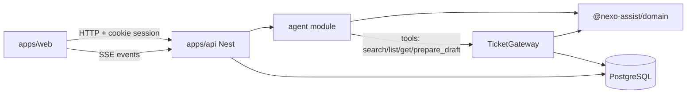

# Architecture

Nexo Assist is a pnpm monorepo that separates **interface**, **agent orchestration**, and **ticket services**, with Annex A rules in a pure domain package.

## Package map

```
apps/web            Next.js — employee chat + analyst console
apps/api            NestJS — session auth, UsageGuard, agent, TicketGateway, SSE
packages/domain     Pure Annex A (priority, SLA, duplicity, confirmation, …)
packages/contracts  Shared Zod schemas / DTO shapes
```

PostgreSQL is the single source of truth for users, sessions, conversations, messages, drafts, tickets, history, help articles, operations, and execution events. The browser does not own authoritative state (`localStorage` is not used as authority).

## Runtime boundaries



| Boundary | Responsibility |
|---|---|
| `apps/web` | UI only: chat, consulta cards, console. Never applies Annex A. |
| `apps/api` agent | Proposes actions via Mastra/scripted tools; HITL draft confirm; handoff offers. |
| `TicketGateway` | Sole mutation path for tickets (create/update/reopen/transfer) with idempotent `operationId`. |
| `@nexo-assist/domain` | Deterministic Annex A decisions — no Nest, no LLM, no I/O. |

## Request / event flow (employee message)

1. Web `POST`s a message with the session cookie.
2. API resolves the employee from the session (client-supplied user ids are ignored).
3. `UsageGuard` enforces message budget, size, and single in-flight execution (`busyUntil` lease).
4. `AgentOrchestrator` accepts the human message, claims a lease, and runs a turn asynchronously.
5. Turn pipeline: early HITL shortcuts → out-of-IT gate → LLM/tools loop → domain policy on drafts → persist messages + execution events.
6. `ConversationEventsService` fans out SSE so the UI updates without polling authority.

Realtime contract details: [`SPEC_HTTP_SSE.md`](./SPEC_HTTP_SSE.md).

## Why this shape

- Matches PRD TECH-8 (clear interface / agent / services separation).
- Keeps model tools **read/propose-only**; mutations require exact draft version confirmation (HITL).
- Allows `LLM_PROVIDER=scripted` CI without changing domain or gateway behavior.

Related ADRs: [`adr/0001-mastra-in-process.md`](./adr/0001-mastra-in-process.md), [`adr/0003-hitl-draft-gateway.md`](./adr/0003-hitl-draft-gateway.md).
